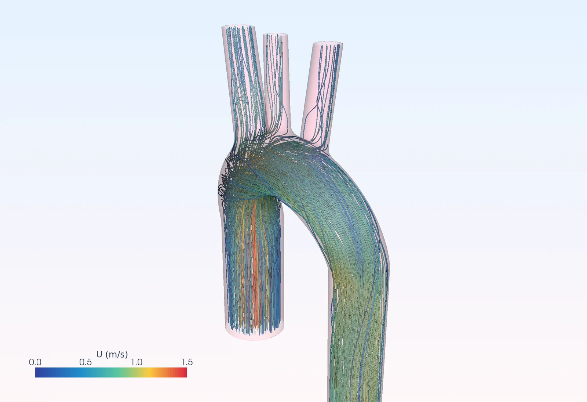
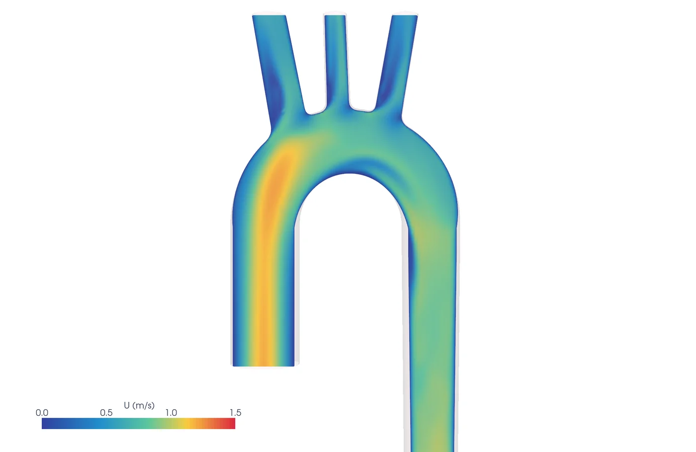
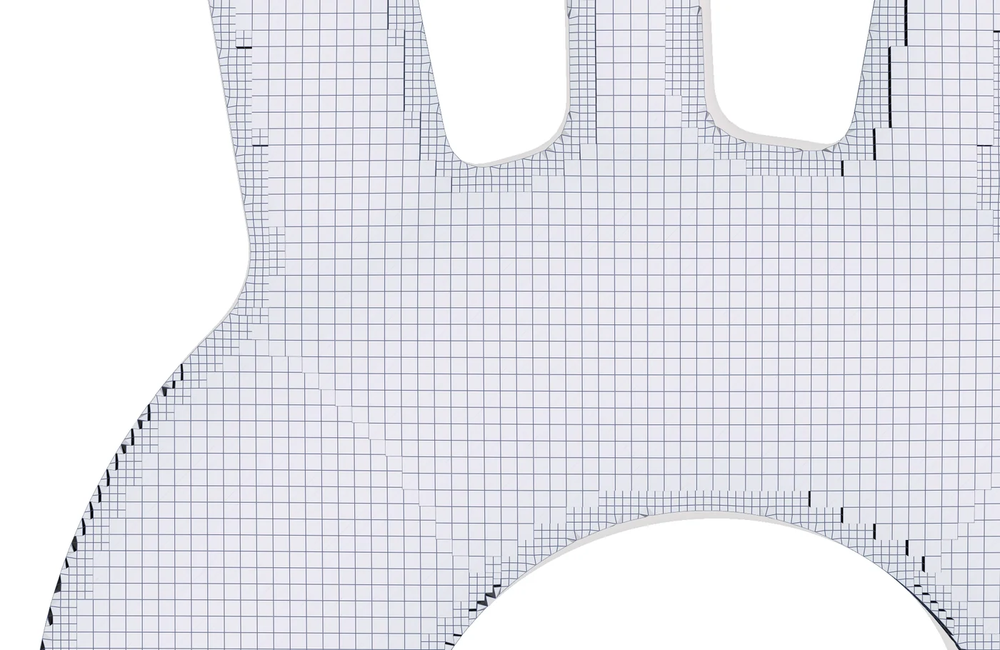

# Pulsatile flow in an aortic arch with RCR Windkessel outlets (OpenFOAM)

Transient CFD simulation of blood flow in an idealised aortic arch with its three supra-aortic branches, driven by a physiological inflow and closed by three-element (RCR) Windkessel boundary conditions at the four outlets.

Everything is scripted: the geometry is generated in Python, the OpenFOAM case is written by a script, and a single `Allrun` rebuilds the mesh and runs two heartbeats.



Detailed case study (EN / FR / AR): <https://walidlakas.com/simulation/cfd/aortic-arch-windkessel>
Background on Windkessel boundary conditions: <https://walidlakas.com/blog/windkessel-boundary-conditions>

## Results (second heartbeat)

| Outlet | Systolic (mmHg) | Diastolic (mmHg) | Mean (mmHg) | Volume per beat (mL) | Share of cardiac output |
|---|---|---|---|---|---|
| Descending aorta | 125.8 | 77.1 | 99.3 | 48.88 | 69.8 % (target 70 %) |
| Brachiocephalic trunk | 127.6 | 77.1 | 100.2 | 10.57 | 15.1 % (target 15 %) |
| Left common carotid | 127.1 | 77.1 | 100.1 | 5.28 | 7.5 % (target 7.5 %) |
| Left subclavian | 125.8 | 77.1 | 99.9 | 5.27 | 7.5 % (target 7.5 %) |

- Mass conservation: 70.0 mL in, 70.0 mL out per beat.
- Pressures are physiological (126/77 mmHg). The mean pressure (≈ 100 mmHg) is slightly above the 93 mmHg used to size the resistances: with a time constant τ = R_d·C ≈ 1.4 s, two heartbeats are not quite enough to reach a fully periodic state.

| Velocity, mid-plane slice at peak systole | Mesh, mid-plane slice |
|---|---|
|  |  |

## Model

| | |
|---|---|
| Geometry | Idealised arch: ascending aorta (Ø 25 mm) → arch (radius 30 mm) → descending aorta (Ø 19 mm), three branches with 3 mm fillets. Built from centrelines and radii (implicit surface + marching cubes), see `scripts/make_geometry.py`. |
| Mesh | `snappyHexMesh`, 1 mm hexahedral background, 0.5 mm at the wall, 354 k cells, `checkMesh` OK (max non-orthogonality 64°). |
| Fluid | Blood as a Newtonian fluid: ρ = 1060 kg/m³, μ = 3.5 mPa·s, laminar. |
| Inlet | `flowRateInletVelocity` with a coded half-sine systolic ejection: 70 mL per beat, 75 bpm, systole 0.3 s, `laminarBL` profile. |
| Outlets | Pressure: `codedFixedValue` implementing an RCR Windkessel (implicit Euler on the capacitor). Velocity: `inletOutlet`. |
| Wall | No-slip, rigid. |
| Solver | `foamRun -solver incompressibleFluid` (PIMPLE, 2 outer correctors), 2nd-order backward time scheme, adaptive time step (max Co 0.9). |

### Windkessel parameters

Total resistance R_tot = P̄ / Q̄ = 93 mmHg / 5.25 L/min, total compliance C_tot = 1.4 mL/mmHg. Each outlet *i* receives a share *f_i* of the cardiac output:

R_i = R_tot / f_i, R_p = 0.06 R_i, R_d = 0.94 R_i, C_i = C_tot · f_i

with f = 70 % (descending), 15 % (brachiocephalic), 7.5 % (carotid), 7.5 % (subclavian). The values are written into `case/0/p` by `scripts/make_case.py`.

## Running the case

Requirements: [OpenFOAM 14](https://openfoam.org) (Foundation version), Python 3 with `numpy` and `vtk`, a C++ compiler (the coded boundary conditions are compiled at run time).

```sh
source /opt/openfoam14/etc/bashrc   # adapt to your installation
./Allrun                            # geometry (~3 min), mesh (~2 min), 2 heartbeats
python3 scripts/extract_results.py  # outlet pressures and flow split
```

The case is decomposed on 12 cores (`case/system/decomposeParDict`); the two heartbeats take about 1 h of solver time on a recent laptop.

Figures:

```sh
python3 scripts/render_streamlines.py case 0.95 streamlines.png
python3 scripts/render_slice.py case 0.95 velocity slice_velocity.png
python3 scripts/render_slice.py case 0.95 mesh slice_mesh.png
```

The rendering scripts read the decomposed case directly (`vtkPOpenFOAMReader`).

### Known issue

`reconstructPar` (OpenFOAM 14) crashes with a segmentation fault when destroying the coded `Function1` of the inlet. The simulation itself is not affected; post-process the decomposed case directly (ParaView: *Case Type → Decomposed Case*).

## Limitations

- Idealised geometry, not patient-specific.
- Rigid walls: no fluid–structure interaction.
- Newtonian blood, laminar flow: peak Reynolds number ≈ 5 700 in the ascending aorta, where transitional effects may appear.
- 0D Windkessel outlets: no wave propagation in the downstream network.
- Only two heartbeats: run longer for a fully periodic state.

## Repository layout

```
Allrun, Allclean           build and run / clean
scripts/make_geometry.py   geometry → case/constant/geometry/aorta.stl (multi-region STL)
scripts/make_case.py       OpenFOAM dictionaries, inflow and Windkessel boundary conditions
scripts/extract_results.py pressures and volumes over the second heartbeat
scripts/render_*.py        figures (VTK, off-screen)
case/                      generated OpenFOAM case (dictionaries only)
results/                   figures and second-heartbeat data
```

## License

MIT, © 2026 Walid Lakas.
